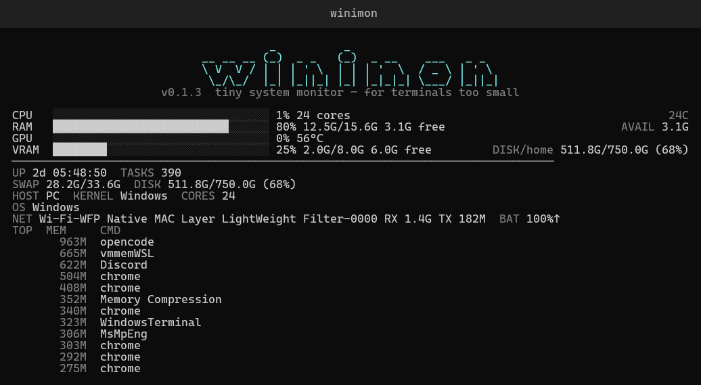
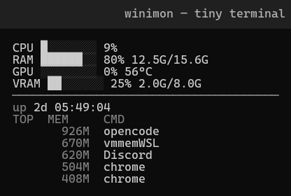

<div align="center">

# winimon

**Windows system monitoring for terminals too small for `btop`.**

`winimon` adapts to your terminal size: tiny terminals stay minimal, while wider and taller terminals show more system information — without turning into a control room.

> **Windows only.** For Linux, use [`minimon`](https://github.com/xonix97/minimon) — same idea, built for Linux.


<br>



<br>

*`winimon` still fits.*

</div>

---

## Why winimon?

`btop` and other system monitors are great when they have space.

Shrink the terminal far enough and things start falling apart.

**winimon is built specifically for tiny terminals on Windows.** It keeps the information you actually want visible:

* CPU usage
* RAM usage and capacity
* GPU usage and temperature
* VRAM usage and capacity
* Compact adaptive bars
* Automatic narrow-terminal layout
* Extra system information when space allows

No giant graphs. No dashboard taking over half your screen.

---

## Adaptive layout

Narrow terminals get compact bars and a minimal footer:

<div align="center">

</div>

```text
CPU █░░░░░░░ 7%
RAM ███████░ 86% 13.4G/15.6G
GPU ░░░░░░░░ 0% 56°C
VRAM ██░░░░░░ 25% 2.0G/8.0G
──────────────────────────────────────
up 2d 05:47:23
TOP  MEM     CMD
      963M  opencode
      885M  vmmemWSL
```

Wider and taller terminals unlock longer bars, inline details (`24C`, `AVAIL`, `DISK/home`), the big `winimon` ASCII header, and richer system info (uptime, tasks, swap, disk, host, kernel, cores, OS, network, battery, top processes).

---

## Quick Start (Windows)

Prerequisite: Rust (provides `cargo`):

```powershell
winget install Rustlang.Rustup
```

Clone, install, run — the installer adds `winimon` to your user `PATH` automatically:

```powershell
git clone https://github.com/xonix97/winimon.git
cd winimon
powershell -NoProfile -ExecutionPolicy Bypass -File .\install.ps1
winimon
```

---

## Installation (Windows)

### Option 1: installer script (recommended)

From the repo directory:

```powershell
powershell -NoProfile -ExecutionPolicy Bypass -File .\install.ps1
```

This:

1. Builds the optimized release binary (`cargo build --release`)
2. Copies `target\release\winimon.exe` to `%USERPROFILE%\.local\bin\winimon.exe`
3. Adds `%USERPROFILE%\.local\bin` to your **user** `PATH` automatically (no admin needed)
4. Verifies with `winimon --version`

Restart open terminals afterwards so they pick up the updated `PATH`.

### Option 2: manual install

```powershell
cargo build --release
New-Item -ItemType Directory -Path "$HOME\.local\bin" -Force
Copy-Item target\release\winimon.exe "$HOME\.local\bin\winimon.exe" -Force
```

Then add `$HOME\.local\bin` to your user `PATH` if it isn't there already (the installer script does this for you).

### Option 3: via Cargo

```powershell
cargo install --path . --force
```

This places `winimon.exe` in your Cargo bin directory (already on `PATH` for standard Rust installs).

---

## If `winimon` is not found

The installer adds `%USERPROFILE%\.local\bin` to your user `PATH` automatically. If a terminal still can't find it:

1. Restart the terminal (open terminals don't reload `PATH`)
2. Verify:

```powershell
$env:Path -split ';'
Get-Command winimon
winimon --version
```

---

## Linux?

`winimon` is **Windows only** and will not run on Linux.

For Linux, use [`minimon`](https://github.com/xonix97/minimon):

```bash
git clone https://github.com/xonix97/minimon.git
cd minimon
cargo build --release
install -Dm755 target/release/minimon ~/.local/bin/minimon
```

---

## Usage

```powershell
winimon                    # run normally
winimon --interval 500     # faster refresh (milliseconds)
winimon --cpu              # CPU only
winimon --ram              # RAM only
winimon --cpu --ram        # CPU and RAM
winimon --gpu              # GPU and VRAM
winimon --minimal          # minimal layout (no bars)
winimon --no-bars          # hide bars
winimon --ascii            # ASCII rendering instead of Unicode
winimon --no-color         # disable ANSI colors
```

---

## Options

```text
winimon [OPTIONS]

--interval MS   Set refresh interval in milliseconds
--cpu           Show CPU
--ram           Show RAM
--gpu           Show GPU and VRAM
--minimal       Hide bars
--no-bars       Hide bars
--ascii         Use ASCII rendering
--no-color      Disable ANSI styling
--version       Show version
--help          Show help
```

---

## Hardware support

| Metric             | Support     |
| ------------------ | ----------- |
| CPU usage          | ✅ Windows   |
| RAM usage          | ✅ Windows   |
| NVIDIA GPU usage   | ✅ Supported |
| NVIDIA temperature | ✅ Supported |
| NVIDIA VRAM        | ✅ Supported |
| AMD GPU            | 🚧 Planned  |
| Intel GPU          | 🚧 Planned  |
| CPU temperature    | 🚧 Planned  |

On Windows, metrics come from native APIs:

* CPU usage: `GetSystemTimes`
* RAM: `GlobalMemoryStatusEx`
* Uptime: `GetTickCount64`
* Disk: `GetDiskFreeSpaceExW`
* Battery: `GetSystemPowerStatus`
* Network: `GetIfTable2`
* Processes: performance counters / `tasklist`

NVIDIA GPU metrics use:

```text
nvidia-smi
```

If no supported GPU is detected, winimon still displays CPU and RAM statistics.

---

## Lightweight by design

winimon is intentionally small.

It doesn't run a daemon. It doesn't need admin. It doesn't need half your screen.

> Show the important system stats in as little terminal space as possible.

---

## Updating

```powershell
cd winimon
git pull
powershell -NoProfile -ExecutionPolicy Bypass -File .\install.ps1
winimon --version
```

---

## Uninstall

```powershell
powershell -NoProfile -ExecutionPolicy Bypass -File .\uninstall.ps1
```

This removes `%USERPROFILE%\.local\bin\winimon.exe` and removes that directory from your user `PATH`. winimon does not install a daemon or scatter configuration files across your system.

---

## Building

```powershell
cargo build              # development build
cargo run                # run directly
cargo build --release    # optimized binary at target\release\winimon.exe
```

---

## Roadmap

* [x] CPU usage
* [x] RAM usage
* [x] NVIDIA GPU utilization
* [x] NVIDIA GPU temperature
* [x] NVIDIA VRAM usage
* [x] Adaptive terminal layout
* [x] Minimal mode
* [x] ASCII fallback
* [x] Automatic PATH setup on install
* [ ] AMD GPU support
* [ ] Intel GPU support
* [ ] CPU temperature
* [ ] Package releases

---

## Philosophy

`winimon` isn't trying to replace `btop`.

If you have an entire terminal available, use `btop`. It's excellent.

winimon is for the terminal where `btop` doesn't fit.

<div align="center">

### Built with Rust. Built to fit. Built for Windows.

</div>
