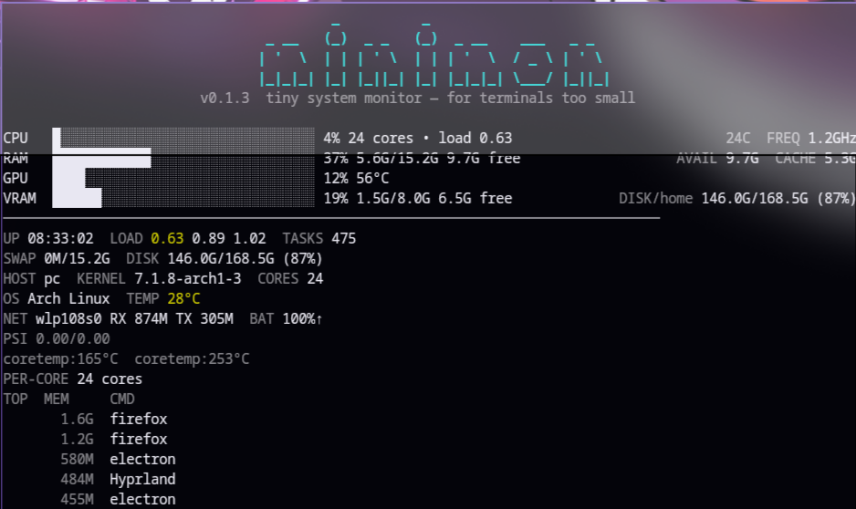
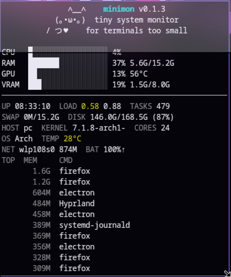
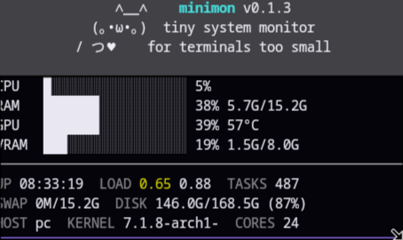
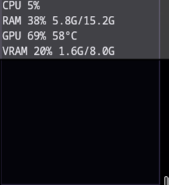
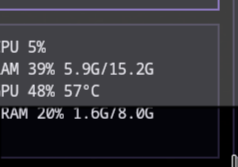

<div align="center">

# minimon

**System monitoring for terminals too small for `btop`.**

`minimon` adapts to your terminal size: tiny terminals stay minimal, while wider and taller terminals show more system information without turning into a terminal dashboard the size of a control room.


<br>

<p align="center">
  
  
  
  
  
</p>

<br>

*`minimon` still fits.*

</div>

---

## Why minimon?

`btop`, `htop`, and other system monitors are great when they have space.

Shrink the terminal far enough and things start falling apart.

**minimon is built specifically for tiny terminals.**

It keeps the information you actually want visible:

* CPU usage
* RAM usage and capacity
* GPU usage and temperature
* VRAM usage and capacity
* Compact adaptive bars
* Automatic narrow-terminal layout
* Extra system information when space allows

No giant graphs. No dashboard taking over half your screen.

---

## Adaptive layout

### Very narrow terminals

Minimal output with no bars:

```text
CPU 6%
RAM 28% 4.2G/15.2G
GPU 10% 54°C
VRAM 7% 611M/8.0G
```

### Narrow terminals

Compact bars:

```text
CPU █░░░░░ 6%
RAM ██░░░░ 28% 4.2G/15.2G
GPU █░░░░░ 10% 54°C
VRAM █░░░░░ 7% 611M/8.0G
```

### Normal terminals

Longer bars and padded labels:

```text
CPU   █░░░░░░░░░░░ 6%
RAM   ███░░░░░░░░░ 28% 4.2G/15.2G
GPU   ██░░░░░░░░░░ 10% 54°C
VRAM  █░░░░░░░░░░░ 7% 611M/8.0G
```

### Wide terminals

More information is shown when space allows:

```text
CPU   █░░░░░░░░░░░ 6% 24 cores • load 1.21
RAM   ███░░░░░░░░░ 28% 4.2G/15.2G 11.0G free
GPU   ██░░░░░░░░░░ 10% 54°C
VRAM  █░░░░░░░░░░░ 7% 611M/8.0G 7.4G free
```

### Wide + tall terminals

Extra system information appears below the main metrics:

```text
CPU   █░░░░░░░░░░░ 6%
RAM   ███░░░░░░░░░ 28% 4.2G/15.2G
GPU   ██░░░░░░░░░░ 10% 54°C
VRAM  █░░░░░░░░░░░ 7% 611M/8.0G
────────────────────────────────────────────────
UP 08:30:34  LOAD 1.21 0.95 0.80  TASKS 452
SWAP 0K/4.0G  DISK 45G/200G (22%)
HOST arch  KERNEL 6.8.9-arch  CORES 8
OS Arch Linux  FREQ 1.4GHz  TEMP 28°C
NET wlp2s0 RX 1.2G TX 300M  BAT 85%
```

Very wide layouts can also show the large `minimon` ASCII header and richer system details.

---

## Quick Start

### Arch Linux / CachyOS

Install Rust if needed:

```bash
sudo pacman -S rustup
rustup default stable
```

Clone, build, and install:

```bash
git clone https://github.com/xonix97/minimon.git
cd minimon
cargo build --release
install -Dm755 target/release/minimon ~/.local/bin/minimon
```

Run:

```bash
minimon
```

---

## Installation

### Arch Linux / CachyOS

Install Rust:

```bash
sudo pacman -S rustup
rustup default stable
```

Clone minimon:

```bash
git clone https://github.com/xonix97/minimon.git
cd minimon
```

Build the optimized release binary:

```bash
cargo build --release
```

Install it:

```bash
install -Dm755 target/release/minimon ~/.local/bin/minimon
```

Or install using Cargo:

```bash
cargo install --path . --force
```

Run:

```bash
minimon
```

---

## If `minimon` is not found

Make sure `~/.local/bin` is in your `PATH`.

### Bash

```bash
echo 'export PATH="$HOME/.local/bin:$PATH"' >> ~/.bashrc
source ~/.bashrc
```

### Zsh

```bash
echo 'export PATH="$HOME/.local/bin:$PATH"' >> ~/.zshrc
source ~/.zshrc
```

### Fish

```fish
fish_add_path ~/.local/bin
```

---

## Other Linux distributions

Install Rust using the official Rust installation method for your distribution.

Once `cargo` is available:

```bash
git clone https://github.com/xonix97/minimon.git
cd minimon
cargo build --release
install -Dm755 target/release/minimon ~/.local/bin/minimon
```

Then:

```bash
minimon
```

---

## Usage

Run minimon normally:

```bash
minimon
```

Set a faster refresh interval:

```bash
minimon --interval 500
```

Show CPU only:

```bash
minimon --cpu
```

Show RAM only:

```bash
minimon --ram
```

Show CPU and RAM:

```bash
minimon --cpu --ram
```

Show GPU and VRAM:

```bash
minimon --gpu
```

Use the minimal layout:

```bash
minimon --minimal
```

Disable bars:

```bash
minimon --no-bars
```

Use ASCII rendering:

```bash
minimon --ascii
```

Disable ANSI colors:

```bash
minimon --no-color
```

---

## Options

```text
minimon [OPTIONS]

--interval MS   Set refresh interval in milliseconds
--cpu           Show CPU
--ram           Show RAM
--gpu           Show GPU and VRAM
--minimal       Hide bars
--no-bars       Hide bars
--ascii         Use ASCII rendering
--no-color      Disable ANSI styling
--version       Show version
--help          Show help
```

---

## Hardware support

| Metric             | Support     |
| ------------------ | ----------- |
| CPU usage          | ✅ Linux     |
| RAM usage          | ✅ Linux     |
| NVIDIA GPU usage   | ✅ Supported |
| NVIDIA temperature | ✅ Supported |
| NVIDIA VRAM        | ✅ Supported |
| AMD GPU            | 🚧 Planned  |
| Intel GPU          | 🚧 Planned  |

CPU usage is read from:

```text
/proc/stat
```

RAM information is read from:

```text
/proc/meminfo
```

NVIDIA GPU metrics currently use:

```text
nvidia-smi
```

---

## NVIDIA GPU support

To check whether NVIDIA monitoring will work:

```bash
nvidia-smi
```

If that command displays your GPU, minimon should automatically detect it.

GPU monitoring includes:

* GPU utilization
* GPU temperature
* VRAM usage
* Total VRAM

If no supported GPU is detected, minimon can still display CPU and RAM statistics.

---

## Lightweight by design

minimon is intentionally small.

It doesn't run a daemon.

It doesn't need root.

It doesn't need half your screen.

The goal is simple:

> Show the important system stats in as little terminal space as possible.

---

## Updating

Go into your cloned repository:

```bash
cd minimon
```

Pull the latest changes:

```bash
git pull
```

Rebuild:

```bash
cargo build --release
```

Replace the installed binary:

```bash
install -Dm755 target/release/minimon ~/.local/bin/minimon
```

Check the version:

```bash
minimon --version
```

---

## Uninstall

Remove the installed binary:

```bash
rm ~/.local/bin/minimon
```

That's it. minimon does not install a daemon or scatter configuration files across your system.

---

## Building

Development build:

```bash
cargo build
```

Run directly:

```bash
cargo run
```

Optimized release build:

```bash
cargo build --release
```

The release binary will be located at:

```text
target/release/minimon
```

---

## Roadmap

* [x] CPU usage
* [x] RAM usage
* [x] NVIDIA GPU utilization
* [x] NVIDIA GPU temperature
* [x] NVIDIA VRAM usage
* [x] Adaptive terminal layout
* [x] Minimal mode
* [x] ASCII fallback
* [ ] AMD GPU support
* [ ] Intel GPU support
* [ ] CPU temperature
* [ ] Package releases

---

## Philosophy

`minimon` isn't trying to replace `btop`.

If you have an entire terminal available, use `btop`. It's excellent.

minimon is for the terminal where `btop` doesn't fit.

<div align="center">

### Built with Rust. Built to fit.

</div>
